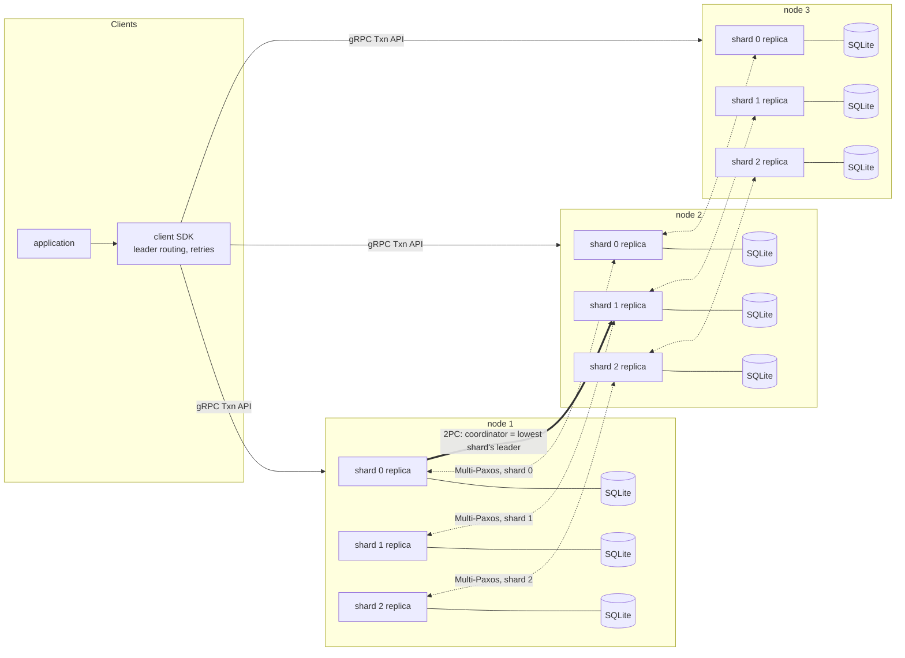

# paxos-txn-store

A sharded transaction store in Go. Each shard is a Multi-Paxos group replicated on three nodes, and transactions that span shards commit with two-phase commit run over those Paxos groups. Transactions are interactive (read, then write, then commit) and **strictly serializable**: the tests build the serialization graph of every committed transaction, real-time order included, and require it to be acyclic. The cluster keeps serving with one of its three nodes down, and a client that loses track of a commit gets an explicit "unknown outcome" error, never a guess. Phase-by-phase design notes are in [DECISIONS.md](DECISIONS.md).

## Architecture



Every node hosts one replica of every shard. Each shard has one leader; a transaction that touches several shards is coordinated by the leader of its lowest shard, and the participants are the other shards' leaders.

Key design choices:

- **Two-phase commit over Paxos groups, Spanner-style.** Prepare records and the commit decision are written to the shards' replicated logs, so a coordinator failure does not block a transaction: the new leader of the coordinator shard knows the decision ([entry 17](DECISIONS.md#17-spanner-style-two-phase-commit-over-paxos-groups), [docs/transactions.md](docs/transactions.md)).
- **Two-phase locking with wound-wait, plus validation at apply time,** at the shard leaders. Older transactions wound younger ones instead of waiting in a cycle ([entry 18](DECISIONS.md#18-wound-wait-for-deadlocks), [entry 19](DECISIONS.md#19-interactive-transactions-instead-of-one-shot)).
- **Reads go through the log,** not leader leases, so a deposed leader cannot serve a stale read ([entry 7](DECISIONS.md#7-reads-through-the-log-instead-of-leader-leases)).
- **Leader election with PreVote, stickiness and CheckQuorum,** so a partitioned or recovering node does not disrupt a working leader ([entry 37](DECISIONS.md#37-leader-stickiness-prevote-refusing-prepares-while-a-leader-is-live-and-checkquorum), [docs/multipaxos.md](docs/multipaxos.md)).
- **One SQLite file per shard replica,** in WAL mode with `synchronous=FULL`: a replica answers only after its write is on disk ([entry 3](DECISIONS.md#3-sqlite-instead-of-rocksdb-for-persistence), [entry 12](DECISIONS.md#12-synchronousfull-not-normal-with-wal), [entry 23](DECISIONS.md#23-one-sqlite-file-per-shard)).
- **One event-loop goroutine per replica.** The Paxos and transaction cores are plain, deterministic Go, run unchanged by a simulated network in tests ([entry 13](DECISIONS.md#13-one-event-loop-goroutine-per-replica-instead-of-mutexes), [entry 4](DECISIONS.md#4-deterministic-simulated-network-for-tests)).
- **An SDK that routes to leaders and reports unknown outcomes.** It never retries a commit into a guess ([entry 24](DECISIONS.md#24-a-txn-service-with-leader-routing-in-the-sdk-replacing-the-kv-service), [entry 25](DECISIONS.md#25-unknown-commit-outcomes-are-reported-never-guessed)).
- **Static hash sharding,** with resharding deferred ([entry 21](DECISIONS.md#21-static-sharding-resharding-deferred)).

## How correctness is tested

- **Seeded simulations:** the Paxos and transaction cores run in a deterministic simulated network that drops, delays, duplicates and reorders messages, partitions nodes and crashes them, over 1000 seeds in CI.
- **Checkers:** log and state-machine safety, linearizability with Porcupine ([entry 8](DECISIONS.md#8-porcupine-for-linearizability-checking)), and strict serializability. The last builds Adya's serialization graph with real-time edges through time-barrier nodes, linear in history size ([entry 39](DECISIONS.md#39-real-time-edges-via-time-barrier-nodes)).
- **Negative tests:** each safety rule is removed in turn, and the checker must catch the violation, so the passing tests cannot be vacuous ([docs/paxos.md](docs/paxos.md#what-breaks-without-each-rule)).
- **Multi-process test:** real processes on SQLite, with leaders SIGKILLed mid-commit.
- **Chaos in CI:** kills, delays, packet loss and partitions against the Docker stack, 2 minutes on every pull request and 20 minutes nightly, followed by the same checkers ([docs/chaos.md](docs/chaos.md)).

## Results

| What | Result | Source |
|---|---|---|
| Local steady state (Phase 9a), low contention, 8 clients | single-shard **545** committed txn/s (p50 13.7 ms); cross-shard 0.5 **244** txn/s (p50 29.0 ms). One 4-vCPU machine, loopback, nodes and load generator sharing CPU and disk: not a multi-machine prediction. | [docs/benchmarks.md](docs/benchmarks.md#results) |
| I5 fix: one node leading every shard, cross-shard 0.5, 32 clients, before and after in the same session | slow host: **37 → 192** txn/s, send-queue drops 58,862 → 0 per run. Faster host: 222 → 341 txn/s. Whether the old code collapsed depended on the host's speed (overload is a threshold), so compare only within a session. | [docs/benchmarks.md](docs/benchmarks.md#leader-placement-after-the-i5-fix) |
| AWS failover, no load (3 × t3.small, 3 AZs, 2026-10-29 UTC) | under **0.35 s** (one shard) and under **0.28 s** (two shards), at 200 ms resolution | [docs/aws.md](docs/aws.md#results-first-aws-run) |
| AWS failover under load (run 2: 32 clients, cross-shard 0.5) | **511 ms** and **392 ms**, both measured. Throughput 124.2 txn/s before the kill, 12.7 with one node down, 95.5 after the rejoin. 13 errors. | [docs/aws.md](docs/aws.md#results-failover-under-load-run-2) |
| Rejoin of a restarted node, before the I4 fix | AWS: **146 s** (down about 3 min) and **32 s** (down about 1 min) | [docs/aws.md](docs/aws.md#results-first-aws-run), [I4](DECISIONS.md#i4-a-restarted-node-stayed-not-ready-for-up-to-two-and-a-half-minutes) |
| Rejoin after the I4 fix | local: **0.61 s** (60 s down) and **1.01 s** (180 s down). AWS: **1.73 s** (run 1) and **3.31 s** (run 2), under load. | [I4](DECISIONS.md#i4-a-restarted-node-stayed-not-ready-for-up-to-two-and-a-half-minutes), [I19](DECISIONS.md#i19-failover-under-load-on-aws-took-167-s-and-the-survivors-nearly-stopped-serving), [docs/aws.md](docs/aws.md#results-failover-under-load-run-2) |
| Correctness | **0 violations** everywhere: a 20-minute nightly chaos run (68,772 committed txns); 10 benchmark histories (102,527); AWS failover runs 1 and 2 (14,175 and 12,034) | [I1](DECISIONS.md#i1-the-nightly-20-minute-chaos-run-never-passed), [docs/benchmarks.md](docs/benchmarks.md#correctness-at-speed), [docs/aws.md](docs/aws.md#results-failover-under-load-run-2) |

## Run it

**The local stack** (three nodes, Prometheus, Grafana, Jaeger), with Docker and Docker Compose v2, from the repository root ([docs/running.md](docs/running.md)):

```sh
docker compose -f deploy/compose.yaml up -d --build --wait
go run ./cmd/loadgen -duration 1m -out history.jsonl
docker compose -f deploy/compose.yaml down
```

Then:

- **Grafana** is at <http://localhost:3000>.
- **Jaeger** is at <http://localhost:16686>.
- **The nodes** take SDK clients on `localhost:7001`, `7002` and `7003`.

**Tests** (see the [Makefile](Makefile)):

```sh
make test        # go test -short ./... (100 seeds per seeded suite)
make test-full   # go test ./... (1000 seeds, as in CI)
make race        # go test -race -short ./...
make lint        # go vet and golangci-lint
```

**A chaos run against the local stack** ([docs/chaos.md](docs/chaos.md)):

```sh
docker build -t paxos-txn-store:dev .
go build -o bin/loadgen ./cmd/loadgen && go build -o bin/chaos ./cmd/chaos
./bin/chaos -duration 2m -loadgen ./bin/loadgen -out chaos-out
```

## Deploying to AWS

Terraform in [deploy/terraform](deploy/terraform) creates three t3.small nodes in three availability zones of us-east-1, with no SSH (operators use SSM), after a one-time bootstrap of the state bucket and a GitHub OIDC deploy role. GitHub Actions workflows deploy a digest-pinned image, run the failover-under-load test, and destroy the cluster, each behind an approval in the `aws` environment. The steps, costs and results are in [docs/aws.md](docs/aws.md).

## Engineering log

The incidents that taught the most, from [DECISIONS.md](DECISIONS.md):

- **[I1](DECISIONS.md#i1-the-nightly-20-minute-chaos-run-never-passed):** the nightly chaos run never passed. The serializability checker was O(N²) and ran the CI runner out of memory, so it was rebuilt to be linear.
- **[I3](DECISIONS.md#i3-the-first-deploy-could-not-assume-the-deploy-role):** the first deploy could not assume its role, because GitHub's OIDC subject carries immutable owner and repository IDs.
- **[I4](DECISIONS.md#i4-a-restarted-node-stayed-not-ready-for-up-to-two-and-a-half-minutes):** a restarted node took up to 146 s to rejoin, because of gRPC's default reconnect backoff. Capping it at 1 s brought rejoin to about a second.
- **[I5](DECISIONS.md#i5-throughput-collapses-when-one-node-leads-every-shard-fixed):** throughput collapsed when one node led every shard. Heartbeats resent every unchosen Accept into overflowing send queues; retransmission is now bounded.
- **[I19](DECISIONS.md#i19-failover-under-load-on-aws-took-167-s-and-the-survivors-nearly-stopped-serving):** the first AWS failover under load nearly stalled. The nodes were throttled by CPU credits, and the client kept retrying a black-holed dead node.
- **[I22](DECISIONS.md#i22-the-failover-sampler-could-make-a-failover-look-slower-than-it-was):** the failover sampler could make a failover look slower than it was. It now logs every read and labels each result measured or uncertain.

## Limitations

- **No transport security:** gRPC runs without TLS, between nodes and to clients ([entry 16](DECISIONS.md#16-insecure-grpc-for-now)).
- **No snapshots or log compaction:** the logs and the replay at startup grow without bound ([entry 9](DECISIONS.md#9-snapshots-and-log-compaction-deferred)).
- **Static sharding:** keys map to shards by hash, and the shard count (3 in `deploy/cluster.json`) is fixed when the cluster is created, with no resharding ([entry 21](DECISIONS.md#21-static-sharding-resharding-deferred)).
- **No leader balancing:** a shard's leader is wherever its election put it, and one node can end up leading every shard ([Future work](DECISIONS.md#future-work)).
- **One region:** the AWS deployment is three AZs in us-east-1 ([entry 41](DECISIONS.md#41-aws-cluster-three-t3small-nodes-in-three-azs-public-subnets-ssm-observability-on-node-1)).
- **Degraded throughput with two of three nodes:** on AWS run 2, 12.7 txn/s with a node down against 124.2 before. The cause is not yet established ([docs/aws.md](docs/aws.md#results-failover-under-load-run-2), [Future work](DECISIONS.md#future-work)).
- **Benchmarks are small:** local numbers come from one shared machine with no network latency. The AWS numbers come from single runs on small burstable instances, with the load generator on a cluster node ([docs/benchmarks.md](docs/benchmarks.md#caveats)).

## Repository layout

```text
api/            types shared by the SDK and the server (transaction IDs, shard function, errors)
client/         the Go SDK
cmd/            paxosd (the node), loadgen (bank workload), chaos (fault injection and checkers)
internal/       paxos, txn, server, storage (SQLite), grpcnet, transport, wire, kv, chaos, testcluster
history/        the workload's history format, read by the checkers
proto/          Protobuf definitions and generated code
deploy/         Docker Compose stack, Prometheus and Grafana config, Terraform (bootstrap, cluster)
scripts/        benchmark, AWS smoke, failover and cleanup scripts
docs/           design notes, runbooks and results
DECISIONS.md    every design decision and incident
```
